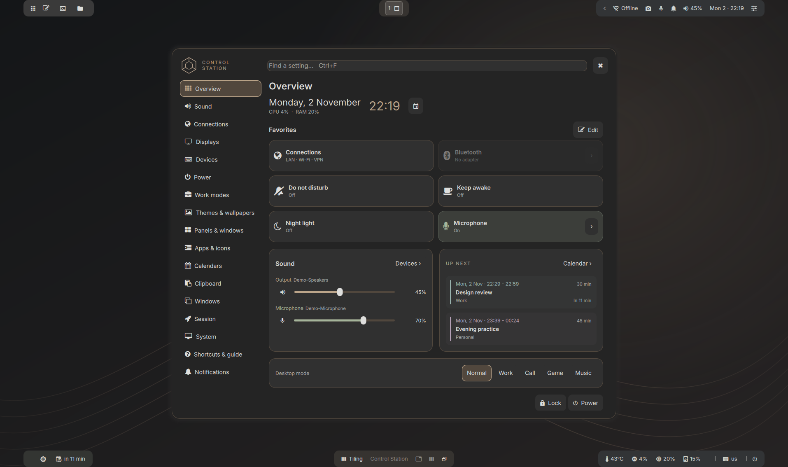
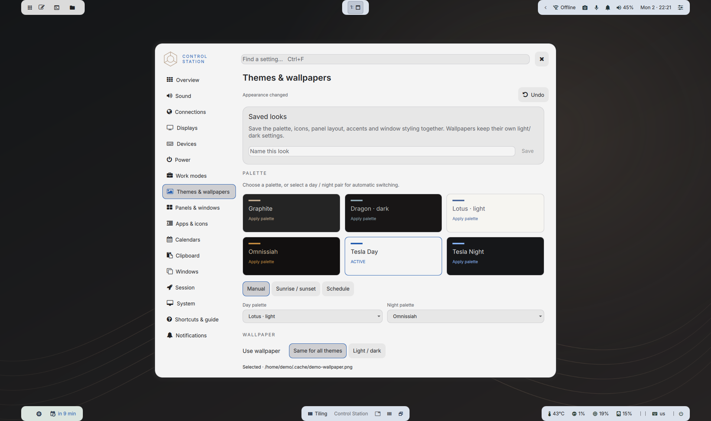
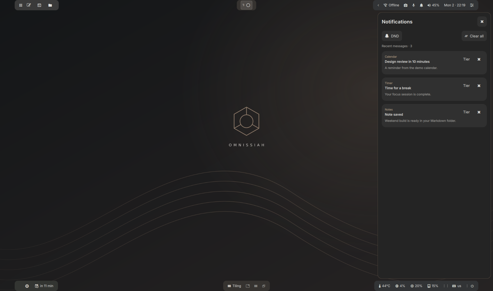
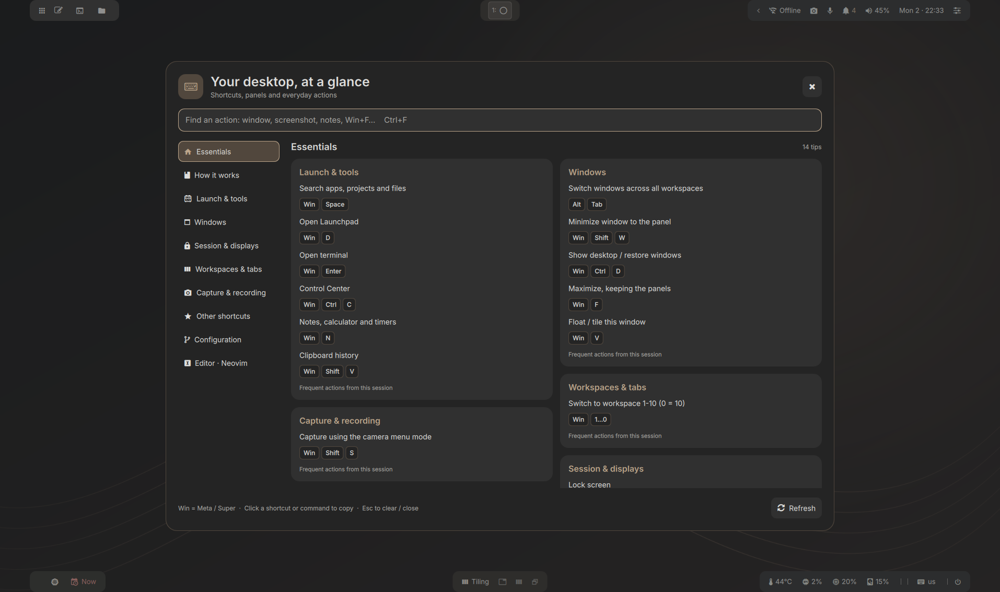

<p align="center"></p>

# Omnissiah Desktop

My Hyprland desktop for getting shit done. Two panels, a Control Center, shared app themes and useful keyboard shortcuts. Runs on **Arch Linux, CachyOS, Ubuntu and Fedora**, using native packages.



## What is inside

- Two panels with workspace numbers, app icons, pinned apps and a system tray.
- Islands that join into a full panel when windows fill the workspace.
- Panel settings for size, corners, colors, groups and transparency.
- A Control Center with search, quick actions, sound, displays, devices and work modes.
- Hover cards for music, calendar, notifications, sound and system usage.
- An app launcher, launchpad, clipboard history and an Alt+Tab switcher.
- A notification center with history, DND, clear buttons and rules for noisy apps.
- A side notebook with Markdown notes, a calculator, timers and reminders. You can point it at an Obsidian vault.
- Calendar support for Google, Microsoft 365 and private iCalendar feeds.
- Six color themes, day/night switching, wallpapers and a lock screen.
- A shortcut guide that reads the current Hyprland bindings.

| Panel settings | Quick notes |
|---|---|
|  |  |
|  |  |

The screenshots use demo data. The wallpaper and project mark are included as SVG files.

## Install

I am targeting **Arch Linux, CachyOS, Ubuntu and Fedora**. Other distros can fuck off for now. Four are enough to keep me busy.

Clone the repo:

```sh
git clone git@github.com:ilyakubryakov/omnissiah-desktop.git
cd omnissiah-desktop
```

Then run:

```sh
./install.sh
```

Fedora needs community packages. Read [the package sources](#install-and-restore) first, then use:

```sh
./install.sh --fedora-copr
```

After installation, log out and select **Hyprland (uwsm)**. You can also run `uwsm start Hyprland` from a local TTY.

| Distribution | Package source |
|---|---|
| Arch Linux | Official packages + a small `python-msal` PKGBUILD |
| CachyOS | The same native package path as Arch |
| Ubuntu 26.10+ | Universe + a local `.deb` with the full icon font |
| Fedora 44+ | Two explicit COPRs + local RPMs for missing dependencies |

Older Ubuntu releases do not have the required runtime in their official repositories. I have tested the UI on Ubuntu and the packages and helpers on Arch and Fedora. CachyOS still needs its own test run. The [test notes](#tests-and-current-limits) have the details.

## A few shortcuts

| Keys | Action |
|---|---|
| Super + Space | Search apps, projects and files |
| Super + D | Launchpad |
| Super + Ctrl + C | Control Center |
| Super + N | Notes, calculator and timers |
| Super + Shift + V | Clipboard history |
| Super + Shift + H | Shortcut guide |
| Alt + Tab | Switch windows across workspaces |
| Super + Return | Terminal |
| Super + L | Lock |



## What the installer changes

The project has no accounts, passwords, VPN profiles, SSH keys or private endpoints. Weather, Prometheus, Kubernetes and AI usage widgets are off until you configure them.

Your settings live outside the installed release. The installer backs up the files it replaces. Uninstall restores those files and keeps later changes in a separate folder. It does not remove your notes or accounts.

Your distribution still manages drivers, networking, the login screen and boot. I leave those alone.

- [Install, update and restore](#install-and-restore)
- [Local settings and integrations](#local-settings)
- [Project structure](#project-structure)
- [Tests and current limits](#tests-and-current-limits)
- [Licenses and credits](NOTICE)

## Install and restore

<details>
<summary>Requirements, package sources, updates and recovery</summary>

I install this on top of an existing Linux desktop. It needs systemd/logind, NetworkManager and a working graphics driver. The supported distro IDs are `arch`, `cachyos`, `ubuntu` and `fedora`. So far I have used x86_64 machines.

The runtime needs Python 3.11+, Hyprland 0.55+ and Quickshell 0.3+. Run the installer as your normal user. It uses sudo only for native packages.

### Before installation

```sh
./install.sh plan --distro ubuntu
```

This shows the package steps without running them. During installation, apt, pacman or dnf shows the real package changes and asks for confirmation where needed.

The installer backs up files it replaces: Hyprland, Quickshell, launcher settings and the application settings changed by the theme. It also saves the desktop font, icon and color settings.

After installation, log out and select **Hyprland (uwsm)**. Without a login manager, use `uwsm start Hyprland` from a local TTY. An ordinary SSH session is not enough to start a desktop.

UWSM starts `omnissiah.target`. This runs the panels, notifications, clipboard, wallpaper, idle/lock, calendar and theme services. The host keeps its own audio, network and login services.

### Where the packages come from

**Arch and CachyOS:** a full `pacman -Syu`, so Qt and Hyprland do not get a partial upgrade. `python-msal` is built with makepkg from the recipe in this repo, then installed through pacman.

**Ubuntu 26.10+:** apt packages from Universe. Ubuntu's `fonts-nerd-symbols` is missing the icon range used by the panels. The installer builds a small `.deb` with the full upstream font. It replaces that reduced font package. Font licenses stay in `/usr/share/doc/omnissiah-symbols-fonts`.

**Fedora 44+:** the official packages are not enough for this version. `--fedora-copr` enables `giperborey/Hyprland` and `errornointernet/quickshell`. These are community repositories, not official Fedora support. Missing idle, calendar and font packages are built as local RPMs. The calendar builds include icalendar because the Fedora package's Python version metadata does not meet the recurrence library's requirement.

All extra source URLs and checksums are in `packaging/`. Builds run as your normal user. No global pip environment or Nix installation is involved. Local packages and build tools remain visible to pacman, apt or dnf.

If you already installed the runtime, use `./install.sh --no-packages`. It still checks the required commands and versions.

### Update

Pull the changes, have a look, then run the installer again. Installed versions live in `~/.local/share/omnissiah/releases/`. A `current` link selects one version. Settings live outside it.

If you replaced a managed link with your own file or folder, the update stops and tells you which path needs attention. It does not overwrite that change.

### Remove or recover

Log out first, then run:

```sh
./install.sh uninstall
```

This restores the configuration saved before the first installation. Later file changes go to `~/.local/state/omnissiah/removed/`. Notes, accounts, wallpapers, saved preferences and native packages stay on the machine. The original backup path is recorded in `~/.local/state/omnissiah/receipt.json` while installed.

If the desktop fails to start, use a TTY and run the same uninstall command from your checkout. Then choose your previous session.

This restores configuration, not old package versions. Use distro snapshots or your normal backup for an OS rollback.

### Limits

I leave GPU drivers, PAM, fingerprint setup, autologin, the bootloader, login screen and network manager to the distro. I want a better desktop, not another bloody OS installer.

Use standard XDG paths under your home. Custom locations are not supported; the installer stops if you use them.

</details>

## Local settings

<details>
<summary>Themes, calendars, notes and other integrations</summary>

I keep most settings in Control Center: colors, wallpapers, panel size, corners, groups, accents, pinned apps, devices and work modes. Drag pinned apps to reorder them; app icons are made monochrome by the shell.

Settings stay under `~/.local/state/theme`, `~/.local/state/station` and `~/.config/theme-schedule.conf`. Theme output is generated from `themes/*/colors.toml`. GTK and Qt6 use the same palette. Electron apps need their system theme setting. Legacy Qt5 apps may need `QT_QPA_PLATFORMTHEME=qt5ct` when launched; the matching qt5ct colors are already written. Applications that cache their own theme may need restarting.

Put extra Hyprland settings in `~/.config/omnissiah/local.lua`. Optional display roles go in `~/.config/omnissiah/monitors.conf`; no hardware role is required. Ordinary outputs use preferred mode/scale 1 until you choose settings in Displays.

### Optional integrations

`~/.config/omnissiah/integrations.json` starts as `{}`. Example fields (add only those you want):

```json
{
  "weather": {"latitude": 51.5074, "longitude": -0.1278},
  "holidays": ["lt", "ie"],
  "clocks": {"UTC": "Etc/UTC", "London": "Europe/London"},
  "ai": ["codex", "claude"],
  "clusters": [],
  "prometheus": "",
  "telemetry": ""
}
```

London is just an example. Weather requests go to Open-Meteo after you supply coordinates. Solar theme scheduling has separate coordinates in `theme-schedule.conf`; set them before selecting Sun mode. Fixed-time and manual scheduling do not need a location.

AI usage reads your locally authorized clients only after opt-in. It does not install clients or authenticate them. Kubernetes targets contain `id`, `label`, `kubeconfig` (filename under `~/.kube/`, or absolute path) and `context`. The widget only reads status and uses timeouts. A Prometheus URL enables alert queries; optional `telemetry` is an HTTPS endpoint returning your own compatible resource summary. Empty fields make no request.

Add calendar accounts and OAuth app details through Calendars. Google and Microsoft tokens stay in your private account configuration. A work account may need your company's approval. This panel reads meetings. For editing them, use your mail or calendar app.

I use the notebook with Obsidian. Its default path is `~/Documents/Notes`. Open that folder as a vault in Obsidian once, or choose an existing vault in Notebook settings. It needs the vault's `.obsidian` folder before saving notes. Files stay as normal Markdown; your sync tool handles other devices. Obsidian itself is not installed by this project.

The icon chooser shows which families are installed. Papirus and Breeze are included; Tela, Colloid and Fluent become available when their native packages are installed. Missing themes are not downloaded behind your back.

Screen recordings go to `~/Videos/Screencasts`. The recorder uses MP4 with H.264/AAC when those encoders are available, or WebM with VP9/Opus on Fedora's free FFmpeg build. Audio and microphone selection are in Capture settings.

VPN profiles come from NetworkManager. Login auto-connect only runs for profiles you enabled in Control Center. The project does not add a VPN profile or enable one by default.

</details>

## Project structure

<details>
<summary>Where the files live and how the desktop starts</summary>

The desktop is split between the Quickshell UI, Hyprland configuration and local helpers.

| Path | What it does |
|---|---|
| `quickshell/` | Panels, Control Center, cards, launchpad, notes and guide |
| `config/hypr/` | Hyprland layout, bindings, rules, idle and lock |
| `dotfiles/.local/bin/` | Small desktop commands |
| `dotfiles/.local/lib/` | Shared Python code |
| `themes/` | Palettes, templates, wallpaper and icon settings |
| `systemd/user/` | Services for the desktop session |
| `installer.py` | Package checks, installation, update and restore |
| `packaging/` | Native packages missing from distro repositories |
| `assets/` | Project artwork |
| `tests/` and `quickshell/tests/` | Installer and desktop tests |

The UI calls local helpers with a fixed set of actions. Text from input fields is passed as data, rather than shell commands. Account data stays in the user's private state directory.

`omnissiah.target` starts the desktop services inside a UWSM session. They stop with the graphical session. The host provides logind, networking, audio and graphics drivers.

Each installed version has a content-based directory name. A `current` link selects the version. User settings, notes and account data stay outside it. The installer records displaced files before replacing them.

</details>

## Tests and current limits

<details>
<summary>What I tested and what still needs work</summary>

I tested this version on 3 November 2026. All Linux packages came from the native package managers and the recipes in this repo. The containers ran on an Intel laptop with a working Wayland session.

### What I checked

| System | Runtime versions | Result |
|---|---|---|
| Ubuntu 26.10 | Hyprland 0.56.2, Quickshell 0.3.0, UWSM 0.26.6 | Packages, doctor, tests and a separate graphical session |
| Arch Linux | Hyprland 0.57.0, Quickshell 0.3.2, UWSM 0.27.1 | Packages, doctor and tests |
| Fedora 44 | Hyprland 0.57.0, Quickshell 0.3.2, UWSM 0.27.0 | COPR/local RPM packages, doctor and tests |
| CachyOS | Uses the Arch package path | Not tested on CachyOS yet |

The Python tests passed on Ubuntu, Arch and Fedora: 9 installer/recording tests and 80 desktop tests on each. Five JavaScript test files also passed. I checked Python and shell syntax, and rendered all six palettes.

The installer tests cover backup, repeated installation, changed managed files, broken symlinks, restore, unsupported systems and real theme output. They use temporary home directories. They do not replace a test of a full desktop login.

Two lock-screen tests depend on the time of day. The final run used `TZ=Etc/GMT+10`, when both could run; all 80 desktop tests passed without skips.

### Graphical check

I started the Ubuntu desktop inside its own Hyprland window, with a separate user and D-Bus session. It had no access to my home directory or accounts. The README screenshots came from this session.

I checked the panels, Control Center, panel editor, dark/light colors, notebook, notification center and shortcut guide. Hyprland reported no configuration errors, and the panel and guide loaded without QML errors. The complete icon font fixed the missing symbols from Ubuntu's smaller font package.

Screen recording produced a real H.264/AAC MP4. Fedora's free FFmpeg build does not include H.264 encoding, so the recorder selects VP9/Opus WebM there. I checked those codecs with a short encode on Fedora; I have not tested Fedora screen capture in a graphical session yet.

I also recorded desktop sound and the demo microphone together. The temporary audio mixer was removed after capture stopped.

The demo scripts in `tests/` are for an isolated `/home/demo` account. They create fake notes, meetings and devices. Do not run them in your daily account.

### Still to test

- A clean install, login and logout through UWSM on each target distro. The container demo starts services directly because it does not run systemd as PID 1.
- The full graphical session on Arch, Fedora and CachyOS.
- Real NVIDIA/AMD hardware, several monitors, suspend, Bluetooth and fingerprint devices.
- Google and Microsoft account setup on a new installation. No real account tokens were copied into the preview.
- Updates across new Hyprland, Qt and Quickshell releases. The package versions above are a test record, not a permanent version lock.

`Hyprland --verify-config` crashed in the Ubuntu container when the config queried live outputs. I checked the running compositor's configuration errors and the UI itself. The checker crash still needs looking at.

</details>

## Development

```sh
python3 -m unittest discover -s tests
python3 -m unittest discover -s quickshell/tests -p 'test_*.py'
TZ=Europe/Vilnius sh -c 'for test in quickshell/tests/*.test.cjs; do node "$test"; done'
./install.sh plan --distro ubuntu
./install.sh doctor
```

The calendar tests need the Python packages listed in `packages.json`.

Use clear names and small functions. Keep comments and docstrings out of code; explanations go here. Executable directives and license notices stay where they belong.

If something breaks, send the logs. "It's fucked" is a fair review, but a poor bug report. Sláinte.
