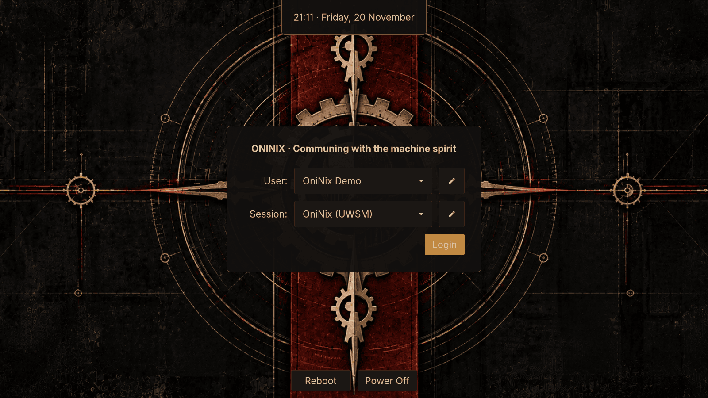
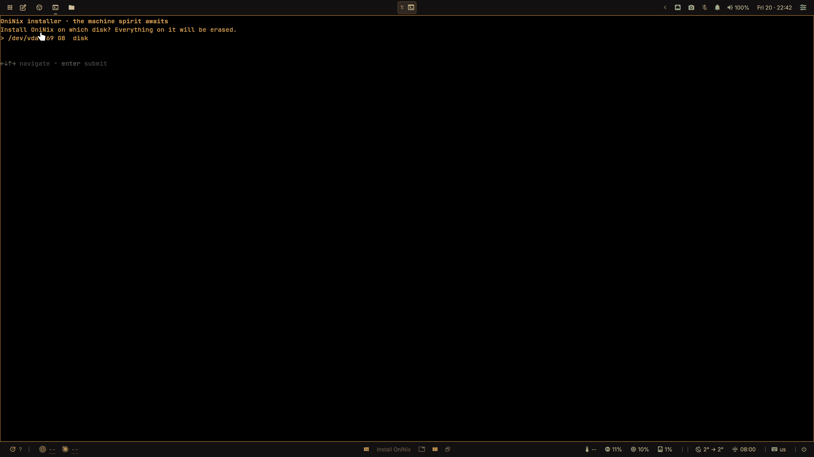
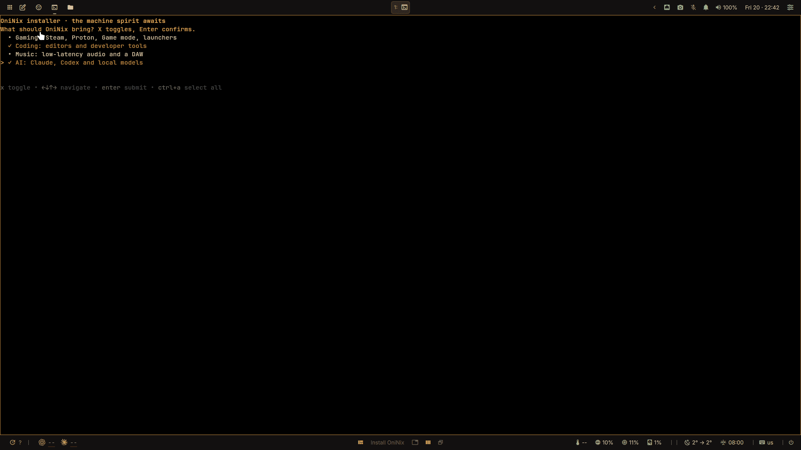
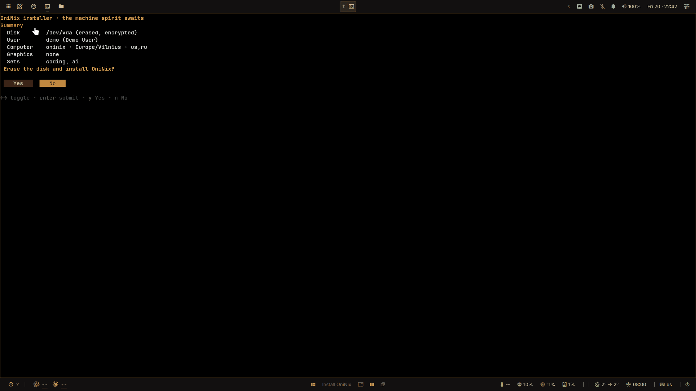

<p align="center"></p>

<h1 align="center">OniNix</h1>
<p align="center"><b>OmnissiaNix.</b> NixOS with my Hyprland desktop, and a machine spirit you can talk to.</p>


This is the desktop I work in every day, packed as a distribution. Two panels, Control Station, notes, a voice you can dictate with, and a machine spirit that changes the system when you ask it. Under it sits NixOS: system rebuilds keep earlier generations, and if something goes sideways I can boot a retained one from GRUB. No heroics.

## Why not just Omarchy

Omarchy is great. It inspired a lot of this and I'm not ashamed. It even has Btrfs snapshots and dictation now. So here is what I wanted that it doesn't do:

| | Omarchy | OniNix |
|---|---|---|
| Base | Arch Linux | NixOS: the whole system is one config you can read |
| Going back | Btrfs snapshots in Limine | Retained system generations in GRUB, packages and config together |
| Changing the system | Menus, scripts, the package manager | Ask the machine spirit, read the diff, apply or don't |
| Settings | Omarchy menu and dotfiles | Control Station, with search |
| Dictation | Superwhisper, local model optional | Local Whisper, sized to your hardware by a benchmark |
| Look | Lots of themes | Live palettes and Mechanicus from GRUB to the lock screen |

[Omarchy snapshots](https://omarchy.org/manual/system-snapshots/) · [Omarchy dictation](https://omarchy.org/news/2026/11/omarchy-4-5/)

## The machine spirit

Press **Super+A**, or hold **Right Ctrl** and say it. "Install Blender." "Turn on the gaming set." "Add the German layout."

1. Claude Code or Codex (sign in to one first) edits a scratch copy of `settings.nix` in a sandbox. OniNix takes only that file as a configuration proposal. The agent CLI can refresh its own login. Your request and configuration can go to the provider, so keep secrets out of both.
2. OniNix builds the proposal. If it doesn't build, nothing happens.
3. You get the config diff and the package diff.
4. **Apply** asks for sudo and switches to exactly the build you looked at. `oninix-spirit undo` brings back the previous settings and system generation.

I read the diff before I apply. You should too: a NixOS config can change anything an admin can. Rollback covers system software and config. Your home files keep their current contents.

I wanted a way to ask for a change, read what it would do and keep a way back.

## Voice

Hold **Right Alt** in a text field, speak, let go. The text lands where your cursor is. Whisper runs on your machine, the audio doesn't go anywhere.

On first login `oninix-voice-profile` looks at what you have (NVIDIA, AMD or Intel through Vulkan, or just the CPU), downloads a model sized for it and benchmarks it. It steps down from that model toward a target of about three seconds. In a VM without GPU, or on a potato, dictation stays off and **Control Station → System → Software → Voice and machine spirit** tells you why and lets you turn it on anyway. Small models are worse with languages other than English. Just so you know.

## What is inside

- Two panels, islands that join when windows fill the screen, drag icons between groups.
- Tiling or floating per workspace: a floating workspace works like a classic desktop, with windows at a comfortable size, shadows and titlebars (close, maximize, minimize to the panel).
- Live wallpapers from Wallpaper Engine's Steam Workshop with the Gaming set: browse, customize and place them; they pause under your windows, step aside in Game mode and when another app needs the video memory.
- Desktop cards: today's agenda on the wallpaper, movable and resizable.
- Control Station: connections, sound, displays, devices, power, themes, panels, apps, work modes, calendars, session.
- Launcher, launchpad, clipboard history with previews, Alt+Tab across workspaces.
- Notebook: Markdown notes (point it at an Obsidian vault), calculator, timers, dictation and meeting transcripts.
- Notifications with history, do not disturb and rules for noisy apps.
- Calendars: Google, Microsoft 365, iCalendar feeds.
- Palettes with day and night switching, wallpapers, lock screen, all in the same colors.
- Game mode with the Gaming set: switches on by itself when a game starts, pauses selected apps and services and restores them when the game closes.
- GRUB, boot splash, login screen and fastfetch in Mechanicus style. Of course.

| Panels | Notebook |
|---|---|
|  |  |
|  |  |

| Boot | Login |
|---|---|
|  |  |

| Installer disk selection | Optional sets | Encrypted install summary |
|---|---|---|
|  |  |  |

The screenshots use a demo account. [Desktop layer on Arch](docs/screenshots/arch-layer.png) · [Encrypted boot](docs/screenshots/luks-unlock.png) · [Boot splash](docs/screenshots/plymouth.png) · [Machine spirit setup](docs/screenshots/spirit-no-agent.png) · [Voice status in a VM](docs/screenshots/voice-disabled.png).

## Install

### Get the ISO

Grab it from [Releases](https://github.com/ilyakubryakov/omnissiah-desktop/releases). GitHub caps files at 2 GiB, so the ISO comes in two parts. Download both parts and `SHA256SUMS` into one folder and join them.

On Linux:

```sh
sha256sum --ignore-missing -c SHA256SUMS
cat oninix-*.iso.part1 oninix-*.iso.part2 > oninix.iso
sha256sum oninix.iso
```

On Windows, paste this into PowerShell in that folder:

```powershell
$iso = Join-Path $PWD 'oninix.iso'
$out = [IO.File]::Create($iso)
Get-ChildItem oninix-*.iso.part? | Sort-Object Name | ForEach-Object { $in = [IO.File]::OpenRead($_.FullName); $in.CopyTo($out); $in.Close() }
$out.Close()
(Get-FileHash $iso).Hash
```

The last hash should match the `.iso` line in `SHA256SUMS` (PowerShell prints it in capitals, that's fine).

### Or build it

You need access to this repository, an SSH key on GitHub, about 25 GB of free disk. The first build downloads around 15 GB.

On Linux, install Git and Nix, then build:

```sh
sh <(curl -L https://nixos.org/nix/install) --daemon
```

Open a new terminal so Nix is on your path:

```sh
git clone git@github.com:ilyakubryakov/omnissiah-desktop.git
cd omnissiah-desktop
nix --extra-experimental-features 'nix-command flakes' build .#iso
cp -L result/iso/*.iso .
```

On Windows, build inside WSL2. In an admin PowerShell:

```powershell
wsl --install -d Ubuntu
```

Reboot if it asks, open **Ubuntu** from the Start menu and create a user. Then run the same Linux commands above inside Ubuntu, and copy the ISO to your Windows Downloads folder:

```sh
cp -L result/iso/*.iso "$(wslpath "$(cmd.exe /c 'echo %USERPROFILE%' 2>/dev/null | tr -d '\r')")/Downloads/"
```

### Write it to a USB stick

This wipes the stick.

On Windows, use [Rufus](https://rufus.ie). Pick the stick under **Device**, the ISO under **Boot selection**, leave **GPT** and **UEFI**, press **START**. When Rufus asks about an ISOHybrid image, choose **Write in DD Image mode**. ISO mode copies files and the stick won't boot.

On Linux, find the stick and write the image to the whole device, not a partition:

```sh
lsblk -d -o NAME,SIZE,MODEL,TRAN
sudo dd if=oninix.iso of=/dev/sdX bs=4M status=progress conv=fsync
```

Replace `sdX` with your stick. Get it wrong and you erase another disk. GNOME Disks with **Restore Disk Image** or Fedora Media Writer do the same with a window.

### Boot and install

Boot the stick in UEFI mode with Secure Boot disabled. The live desktop has an **Install OniNix** button. Have an internet connection and an available target disk of at least 32 GB.

I tested the base desktop with two x86-64 CPU cores, 2 GiB of RAM and a graphics adapter that Hyprland can use through DRM/KMS. I use 2 GiB as the minimum and recommend 4 GiB for installation and running several apps. The installer filled swap at 2 GiB, and the system killed a process under memory pressure at 1 GiB.

The installer asks for the disk, encryption, your name, login, password, computer name, time zone and keyboard layouts. Graphics and laptop are detected. Then you tick what you want:

- **Gaming:** Steam, Proton, Game mode, launchers
- **Coding:** editors, toolchains, developer tools
- **Music:** low-latency audio and a DAW
- **AI:** Claude Code and Codex (the machine spirit needs one of them) and local models through Ollama

It erases the disk you picked, and it asks before it does. Read the summary.

Your machine config lives in `/etc/nixos`: `settings.nix` is yours (and the spirit's), the rest is generated.

## On Ubuntu, Fedora or Arch

I made this desktop available as a Nix layer on x86-64. From a clone of this repository, run:

```sh
./oninix-install
```

I tested Ubuntu 26.10, Fedora 45 and current Arch. On Fedora, run `./oninix-install --fedora-copr` to enable the community `sdegler/hyprland` COPR for the Hyprland stack. Arch runs a normal full pacman upgrade. Pick **OniNix** at the login screen.

The layer uses Hyprland's Lua configuration and needs Hyprland 0.55 or newer. Ubuntu 26.04 LTS ships an older version. I run the installer with my regular user and authenticate through sudo if asked.

On first install you can pipe a downloaded installer into `bash -s -- --source FLAKE`. With no `--source`, the script uses this GitHub repository over SSH. Reinstalling keeps the source in your saved layer flake.

I use the distro's Hyprland, lock screen, login, audio and graphics drivers. The same OniNix panels and tools come from Nix. The panels use Qt software rendering and the layer currently profiles Whisper on the CPU. Apps I add that need OpenGL or Vulkan may need a driver wrapper.

**Super+A** still opens the machine spirit. It can change the list of nixpkgs package names in `~/.config/oninix/layer/flake.nix`. Sign in to Claude Code or Codex first. Review the build and apply it, or run `oninix-spirit undo` to roll back the profile. Sign out and back in to reload it. Full system rollback requires OniNix on NixOS. For a local clone, pull the branch before checking for a layer update.

To remove the layer, sign out and run `./oninix-install uninstall` from the clone. I leave your settings, Nix and the packages the installer added through your distro package manager in place. In my test VMs, that left 364 additional packages on Ubuntu, 479 on Fedora and 218 on Arch. If OniNix set up SDDM, removing the last OniNix user restores the previous login setup for the next boot.

## Updates and going back

The panel checks the OniNix input about once a day. **Update** opens a terminal to update that input and rebuild. While the upstream is private, Nix needs authenticated access to it, including for the sudo update command. If a rebuild changes the system, the previous generation remains in GRUB until you remove it.

I use `oninix-doctor` to check failed services, disk health, crashes and backups. `oninix-doctor --events` shows the last day of activity, and `/var/lib/oninix-maintenance/last-rebuild.txt` shows the package changes from my last switch.

I can enable local backups with `oninix.backup.enable = true;` in `settings.nix`. I mount a root-owned backup disk at `/mnt/oninix-backup` (or set `oninix.backup.mountPoint`), create a root-owned password file at `/etc/oninix/backup-password` with mode 0600, and keep a separate copy of the password. After a rebuild, `sudo oninix-backup init` creates the encrypted restic repository. OniNix backs up my home and `/etc/nixos` daily and tests a restore weekly. I can run `sudo oninix-backup snapshots` or `sudo oninix-backup restore latest /path/to/empty-directory` whenever I need it.

I can also set `oninix.hardware.autoMount = true;` to mount removable media automatically when my desktop session is active.

## Keys worth knowing

| Keys | Action |
|---|---|
| Super + A | Machine spirit |
| Hold Right Ctrl | Talk to the machine spirit |
| Hold Right Alt | Dictate into the focused field |
| Super + Space | Search apps, projects and files |
| Super + D | Launchpad |
| Super + , | Control Station |
| Super + Ctrl + C | Quick toggles and sliders |
| Super + N | Notebook |
| Super + Shift + V | Clipboard history |
| Super + / | Shortcuts you use every day |
| Super + Shift + H | Every shortcut |
| Alt + Tab | Switch windows |
| Super + Return | Terminal |
| Super + Shift + Space | Float or tile the current workspace |
| Super + L | Lock |


## Make it yours

- Drop a `~/.config/oninix/hypr/user.lua` for your own Hyprland bits, or a module with the same name as one of ours to replace it.
- Palettes, wallpapers, panels and icons are in Control Station.
- System stuff goes to `/etc/nixos/settings.nix`, by hand or through the spirit.

## Repository

| Path | What |
|---|---|
| `flake.nix` | The NixOS module, the ISO and the demo VM |
| `nix/modules/` | System side: desktop, boot, voice, updates, the spirit |
| `nix/installer/` | The disk installer |
| `nix/layer/`, `oninix-install` | The desktop layer and its distro installer |
| `nix/template/` | The machine flake the installer writes |
| `desktop/hypr/` | Hyprland, in Lua |
| `desktop/quickshell/` | Panels, Control Station, Notebook |
| `desktop/bin/`, `desktop/lib/` | The `oninix-*` commands |
| `desktop/themes/` | Palettes and templates, rendered at build time |
| `docs/` | Screenshots and the one-page site |

`nix flake check` builds the demo system and runs the repository checks. `nix build .#nixosConfigurations.demo.config.system.build.vm` gives you a VM to poke at.

## Licenses

MIT for my code. Palettes, fonts and the rest keep their own licenses, see [NOTICE](NOTICE).
