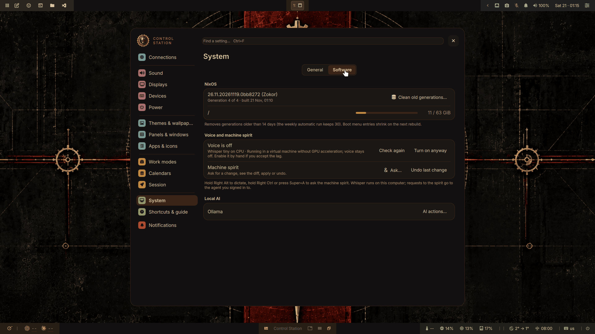
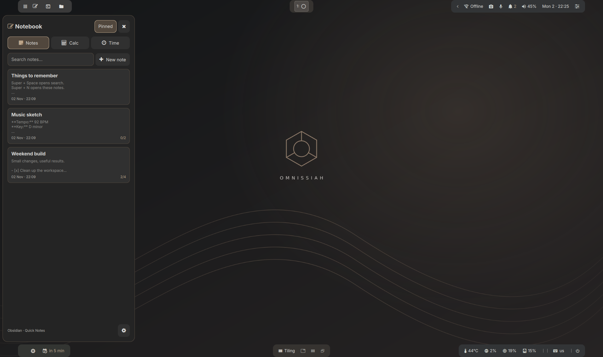
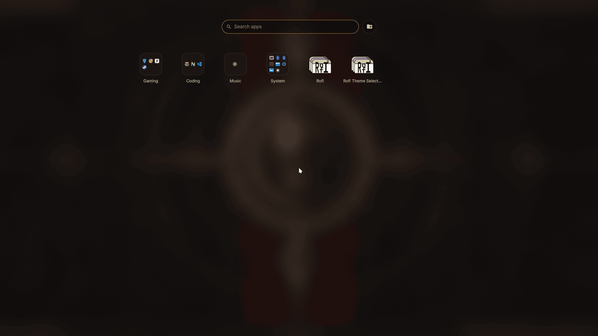
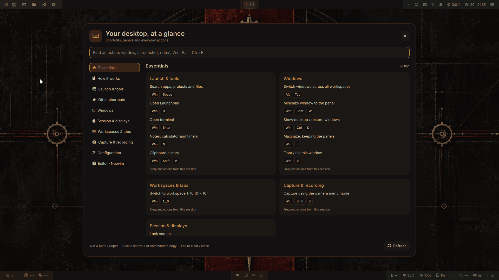

<p align="center"></p>

<h1 align="center">OniNix</h1>
<p align="center"><b>OmnissiaNix.</b> NixOS with my Hyprland desktop, and a machine spirit you can talk to.</p>



This is the desktop I work in every day, packed as a distribution. Two panels, Control Station, notes, a voice you can dictate with, and a machine spirit that changes the system when you ask it. Under it sits NixOS, so nothing you or the spirit do can leave the machine broken. The previous system is always one click away.

## Why not just Omarchy

Omarchy is great. I stole ideas from it and I'm not ashamed. But it is Arch plus scripts, and that has a price: when an update or a clever script goes sideways, you fix it by hand.

| | Omarchy | OniNix |
|---|---|---|
| Base | Arch + install scripts | NixOS, the whole system is one config |
| Bad update | Fix it yourself | Pick the previous system in the boot menu |
| Change the system | Edit configs or run scripts | Ask the machine spirit, see the diff, apply or undo |
| Settings | Config files | Control Station, search included |
| Voice | No | Hold Right Alt to dictate anywhere, Whisper picked for your hardware |
| Looks | Many themes | Many palettes, live switching, Mechanicus everywhere |

## The machine spirit

Press **Super+A**, or hold **Right Ctrl** and say it. Something like "install Blender", "turn on the gaming set" or "add the German layout".

1. Claude Code or Codex (whichever you signed in to) edits a copy of your machine config. Not the real one.
2. OniNix builds the new system from that copy. Nothing changes yet.
3. You see what changes: the config diff and the package list.
4. **Apply** switches to it. Don't like it? `oninix-spirit undo` and you are back.

NixOS makes letting an AI touch your system safe. The AI makes NixOS usable for people who don't want to learn Nix. That's the whole idea.

## Voice

Hold **Right Alt** in any text field, speak, let go. The text lands where your cursor is. It runs locally with Whisper, nothing leaves the machine.

On the first login `oninix-voice-profile` checks your hardware and benchmarks Whisper: NVIDIA, AMD and Intel GPUs through Vulkan, or the CPU. It takes the biggest model that still answers in about three seconds, from tiny to large-v3-turbo. In a virtual machine without GPU, or on a potato, voice stays off. Control Station (System, Software) tells you why and has a button to turn it on anyway. Small models are worse with languages other than English. Just so you know.

## What is inside

- Two panels, islands that join when windows fill the screen, drag icons between groups.
- Control Station: connections, sound, displays, devices, power, themes, panels, apps, work modes, calendars, session.
- Launcher, launchpad, clipboard history with previews, Alt+Tab across workspaces.
- Notebook: Markdown notes (point it at an Obsidian vault), calculator, timers, dictation and meeting transcripts.
- Notifications with history, do not disturb and rules for noisy apps.
- Calendars: Google, Microsoft 365, iCalendar feeds.
- Palettes with day and night switching, wallpapers, lock screen, all in the same colors.
- Game mode: closes the heavy apps, gives the game the machine, puts everything back after.
- GRUB, boot splash and login screen in Mechanicus style. Of course.

| Panels | Notebook |
|---|---|
|  |  |
|  |  |

| Boot | Login |
|---|---|
|  |  |

The screenshots use a demo user and demo data.

## Install

Build the ISO:

```sh
nix build github:ilyakubryakov/omnissiah-desktop/oninix#iso
```

Write `result/iso/*.iso` to a USB stick (`dd`, Ventoy, whatever you like) and boot it in UEFI mode. You land in a live OniNix desktop. Look around, then press **Install OniNix**.

The installer asks for the disk, encryption, your name, login, password, computer name, time zone and keyboard layouts. Graphics and laptop are detected. Then you tick what you want:

- **Gaming:** Steam, Proton, Game mode, launchers
- **Coding:** editors, toolchains, developer tools
- **Music:** low-latency audio and a DAW
- **AI:** Claude Code and Codex (the machine spirit needs one of them) and local models through Ollama

It erases the disk you picked. It asks twice. Read the summary.

Your machine config lives in `/etc/nixos`: `settings.nix` is yours (and the spirit's), the rest is generated.

## Updates and going back

The panel checks for an OniNix update once a day and tells you when it is time. **Update** opens a terminal, pulls the new OniNix and rebuilds. Every update and every spirit change is a new system generation. If something is off, reboot and pick the previous one in GRUB.

## Keys worth knowing

| Keys | Action |
|---|---|
| Super + A | Machine spirit |
| Hold Right Ctrl | Talk to the machine spirit |
| Hold Right Alt | Dictate into the focused field |
| Super + Space | Search apps, projects and files |
| Super + D | Launchpad |
| Super + , | Control Station |
| Super + Ctrl + C | Quick toggles and sliders |
| Super + N | Notebook |
| Super + Shift + V | Clipboard history |
| Super + / | Shortcuts you use every day |
| Super + Shift + H | Every shortcut |
| Alt + Tab | Switch windows |
| Super + Return | Terminal |
| Super + L | Lock |



## Make it yours

- Drop a `~/.config/oninix/hypr/user.lua` for your own Hyprland bits, or a module with the same name as one of ours to replace it.
- Palettes, wallpapers, panels and icons are in Control Station.
- System stuff goes to `/etc/nixos/settings.nix`, by hand or through the spirit.

## Repository

| Path | What |
|---|---|
| `flake.nix` | The NixOS module, the ISO and the demo VM |
| `nix/modules/` | System side: desktop, boot, voice, updates, the spirit |
| `nix/installer/` | The installer |
| `nix/template/` | The machine flake the installer writes |
| `desktop/hypr/` | Hyprland, in Lua |
| `desktop/quickshell/` | Panels, Control Station, Notebook |
| `desktop/bin/`, `desktop/lib/` | The `oninix-*` commands |
| `desktop/themes/` | Palettes and templates, rendered at build time |
| `docs/` | Screenshots and the one-page site |

`nix flake check` builds the demo system. `nix build .#nixosConfigurations.demo.config.system.build.vm` gives you a VM to poke at.

## Licenses

MIT for my code. Palettes, fonts and the rest keep their own licenses, see [NOTICE](NOTICE).
