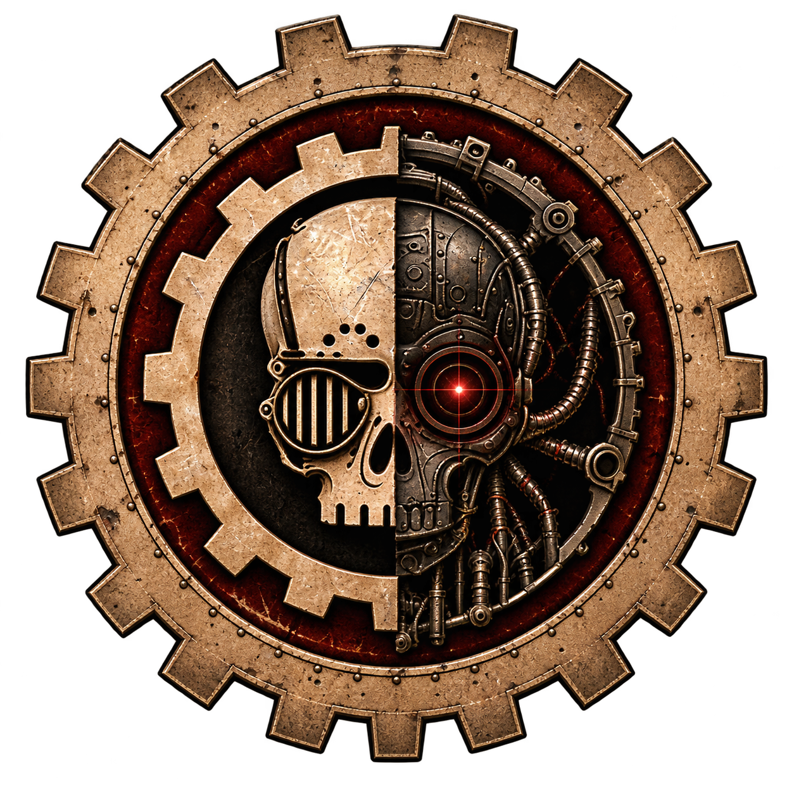
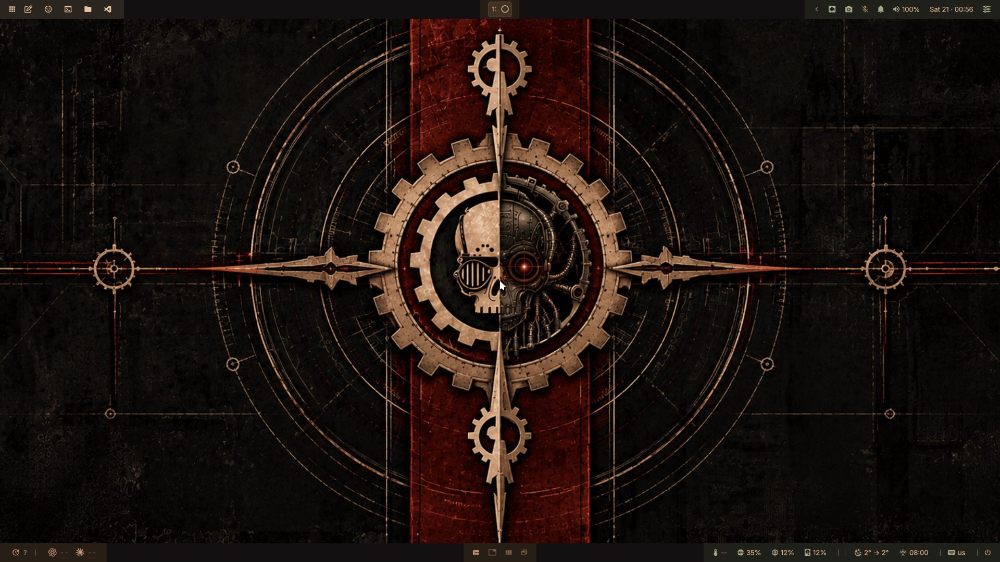
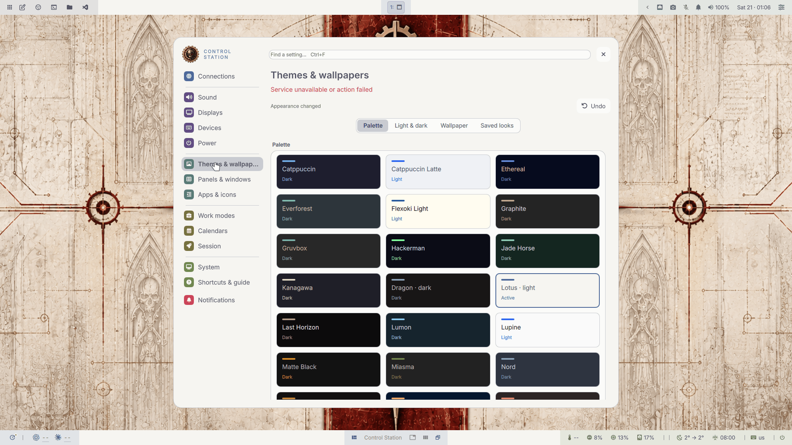
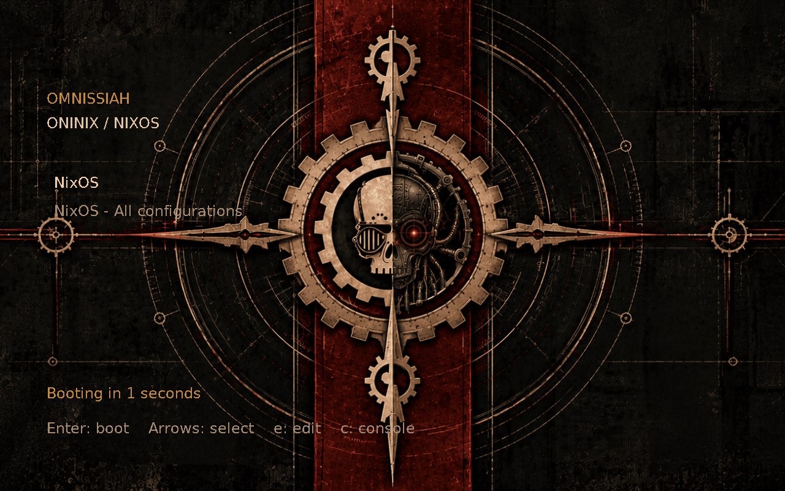

<p align="center"></p>

<h1 align="center">OniNix</h1>
<p align="center"><b>OmnissiaNix.</b> NixOS with my Hyprland desktop, and a machine spirit you can talk to.</p>


This is the desktop I work in every day, packed as a distribution. Two panels, Control Station, notes, a voice you can dictate with, and a machine spirit that changes the system when you ask it. NixOS keeps previous system generations. If a change breaks the desktop, I can boot a retained generation from GRUB.

## Why not just Omarchy

Omarchy inspired this setup. I wanted the desktop I use every day with NixOS generations, a searchable Control Station and a way to preview system changes.

| | Omarchy | OniNix |
|---|---|---|
| Base | Arch Linux | NixOS |
| Rollback | Btrfs snapshots in Limine | Retained NixOS generations in GRUB |
| Settings | Omarchy menu and dotfiles | Control Station and a Nix flake |
| Dictation | Superwhisper, with a local model option | Local Whisper with automatic model sizing |
| System change workflow | Omarchy tools and package manager | Build an agent proposal, review the diff, then choose whether to apply |

[Omarchy snapshots](https://omarchy.org/manual/system-snapshots/) · [Omarchy dictation](https://omarchy.org/news/2026/11/omarchy-4-5/)

## The machine spirit

Press **Super+A**, or hold **Right Ctrl** and say it. Something like "install Blender", "turn on the gaming set" or "add the German layout".

1. Claude Code or Codex edits a scratch copy of `settings.nix`. Sign in to an agent first. The request and configuration can be sent to its provider.
2. OniNix builds the proposal and shows the configuration and package diffs.
3. **Apply** asks for sudo and activates the reviewed build. `oninix-spirit undo` restores the preceding settings and system generation.

I read the diff before applying. A NixOS configuration can change anything the system administrator can configure. Generation rollback restores system software and configuration. Home files and other mutable data keep their current contents.

## Voice

Hold **Right Alt** in a focused text field, speak, then let go to insert the transcription. Whisper processes the audio locally. The model downloads on first use or during profiling.

On first login `oninix-voice-profile` checks the available compute backend, starts with a model sized for the hardware and benchmarks toward a latency target of about three seconds. In a VM without GPU acceleration or when the benchmark is too slow, dictation stays off. Open **Control Station → System → Software → Voice and machine spirit** for the reason and a manual override.

## What is inside

- Two panels, islands that join when windows fill the screen, drag icons between groups.
- Control Station: connections, sound, displays, devices, power, themes, panels, apps, work modes, calendars, session.
- Launcher, launchpad, clipboard history with previews, Alt+Tab across workspaces.
- Notebook: Markdown notes (point it at an Obsidian vault), calculator, timers, dictation and meeting transcripts.
- Notifications with history, do not disturb and rules for noisy apps.
- Calendars: Google, Microsoft 365, iCalendar feeds.
- Palettes with day and night switching, wallpapers, lock screen, all in the same colors.
- Game mode with the Gaming set: pause selected apps and services and restore them when you leave Game mode.
- GRUB, boot splash and login screen in Mechanicus style. Of course.

| Panels | Notebook |
|---|---|
|  |  |
|  |  |

| Boot | Login |
|---|---|
|  |  |

| Installer disk selection | Optional sets | Encrypted install summary |
|---|---|---|
|  |  |  |

The screenshots use a demo account. [Desktop layer on Arch](docs/screenshots/arch-layer.png) · [Encrypted boot](docs/screenshots/luks-unlock.png) · [Boot splash](docs/screenshots/plymouth.png) · [Machine spirit setup](docs/screenshots/spirit-no-agent.png) · [Voice status in a VM](docs/screenshots/voice-disabled.png).

## Install

Build from a checkout on x86-64 Linux with Nix. Access to this repository is required.

```sh
git clone --branch oninix git@github.com:ilyakubryakov/omnissiah-desktop.git
cd omnissiah-desktop
nix --extra-experimental-features 'nix-command flakes' build .#iso
```

Write the ISO in `result/iso/` as a disk image to a USB stick. Boot in UEFI mode with Secure Boot disabled. The live desktop has an **Install OniNix** button. Have an internet connection and an available target disk of at least 32 GB.

The installer asks for the disk, encryption, your name, login, password, computer name, time zone and keyboard layouts. Graphics and laptop are detected. Then you tick what you want:

- **Gaming:** Steam, Proton, Game mode, launchers
- **Coding:** editors, toolchains, developer tools
- **Music:** low-latency audio and a DAW
- **AI:** Claude Code and Codex (the machine spirit needs one of them) and local models through Ollama

Read the summary and confirm the erase. Installation replaces the contents of the selected disk.

Your machine config lives in `/etc/nixos`: `settings.nix` is yours (and the spirit's), the rest is generated.

## On Ubuntu, Fedora or Arch

I made this desktop available as a Nix layer on x86-64. From a clone of the `oninix` branch, run:

```sh
./oninix-install
```

I tested Ubuntu 26.10, Fedora 45 and current Arch. On Fedora, run `./oninix-install --fedora-copr` to enable the community `sdegler/hyprland` COPR for the Hyprland stack. Arch runs a normal full pacman upgrade. Pick **OniNix** at the login screen.

On first install you can pipe a downloaded installer into `bash -s -- --source FLAKE`. With no `--source`, the script uses this GitHub branch over SSH. Reinstalling keeps the source in your saved layer flake.

I use the distro's Hyprland, lock screen, login, audio and graphics drivers. The same OniNix panels and tools come from Nix. The panels use Qt software rendering and the layer currently profiles Whisper on the CPU. Apps I add that need OpenGL or Vulkan may need a driver wrapper.

**Super+A** still opens the machine spirit. It can change the list of nixpkgs package names in `~/.config/oninix/layer/flake.nix`. Sign in to Claude Code or Codex first. Review the build and apply it, or run `oninix-spirit undo` to roll back the profile. Sign out and back in to reload it. Full system rollback requires OniNix on NixOS. For a local clone, pull the branch before checking for a layer update.

To remove the layer, sign out and run `./oninix-install uninstall` from the clone. Your settings, Nix and distro packages stay.

## Updates and going back

The panel checks the OniNix input about once a day. **Update** opens a terminal to update that input and rebuild. While the upstream is private, Nix needs authenticated access to it, including for the sudo update command. If a rebuild changes the system, the previous generation remains in GRUB until you remove it.

## Keys worth knowing

| Keys | Action |
|---|---|
| Super + A | Machine spirit |
| Hold Right Ctrl | Talk to the machine spirit |
| Hold Right Alt | Dictate into the focused field |
| Super + Space | Search apps, projects and files |
| Super + D | Launchpad |
| Super + , | Control Station |
| Super + Ctrl + C | Quick toggles and sliders |
| Super + N | Notebook |
| Super + Shift + V | Clipboard history |
| Super + / | Shortcuts you use every day |
| Super + Shift + H | Every shortcut |
| Alt + Tab | Switch windows |
| Super + Return | Terminal |
| Super + L | Lock |


## Make it yours

- Drop a `~/.config/oninix/hypr/user.lua` for your own Hyprland bits, or a module with the same name as one of ours to replace it.
- Palettes, wallpapers, panels and icons are in Control Station.
- System stuff goes to `/etc/nixos/settings.nix`, by hand or through the spirit.

## Repository

| Path | What |
|---|---|
| `flake.nix` | The NixOS module, the ISO and the demo VM |
| `nix/modules/` | System side: desktop, boot, voice, updates, the spirit |
| `nix/installer/` | The disk installer |
| `nix/layer/`, `oninix-install` | The desktop layer and its distro installer |
| `nix/template/` | The machine flake the installer writes |
| `desktop/hypr/` | Hyprland, in Lua |
| `desktop/quickshell/` | Panels, Control Station, Notebook |
| `desktop/bin/`, `desktop/lib/` | The `oninix-*` commands |
| `desktop/themes/` | Palettes and templates, rendered at build time |
| `docs/` | Screenshots and the one-page site |

`nix flake check` builds the demo system and runs the repository checks. `nix build .#nixosConfigurations.demo.config.system.build.vm` gives you a VM to poke at.

## Licenses

MIT for my code. Palettes, fonts and the rest keep their own licenses, see [NOTICE](NOTICE).
